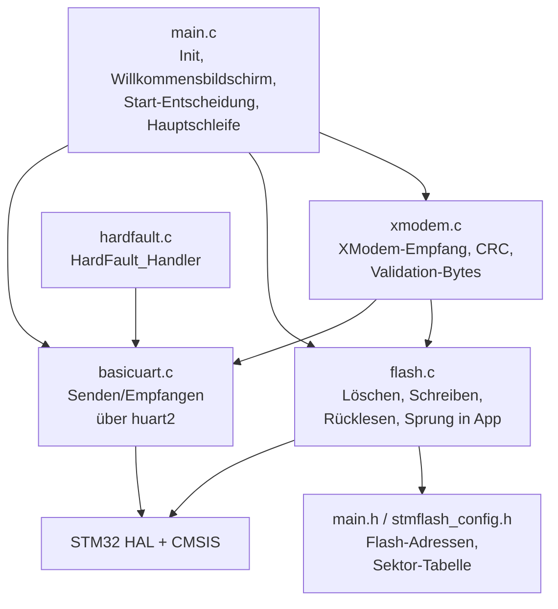
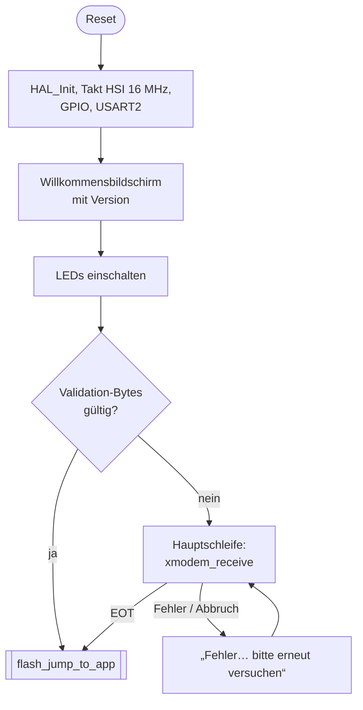
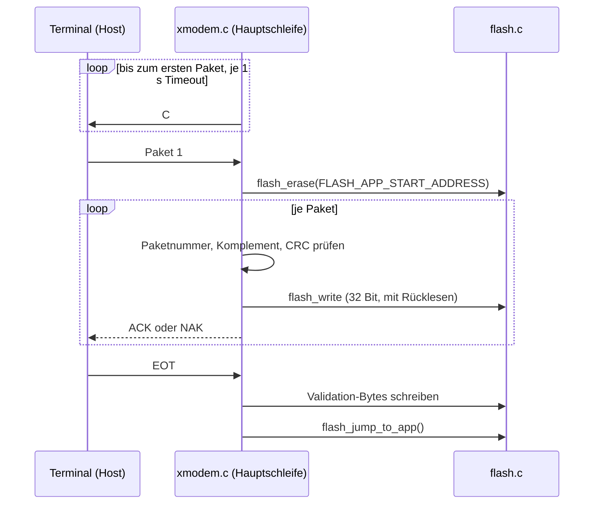

# Architektur EAuto Bootloader

Der Bootloader liegt im ersten Flash-Sektor eines STM32F767ZIT und startet nach jedem
Reset eine gültige Application direkt. Fehlt sie, empfängt er eine neue Firmware per
XModem über USART2 und schreibt sie in den restlichen Flash. Die Logik für XModem und
Flash kommt aus der Bibliothek STM32_BootloaderXModem, dieses Projekt legt Adressen,
Pinbelegung und den Ablauf beim Start fest.

## Komponenten

| Modul | Datei(en) | Aufgabe |
|:----- |:--------- |:------- |
| Projektcode | `Core/Src/main.c`, `Core/Inc/main.h`, `Core/Inc/version.h` | Start-Entscheidung und Hauptschleife, Pinbelegung je Platine, Flash-Adressen, Version des Bootloaders |
| CubeMX-Initialisierung | `Core/Src/gpio.c`, `Core/Src/usart.c`, `Core/Src/stm32f7xx_it.c` | Takt, GPIO, USART2, Interrupt-Handler |
| XModem | `Lib/STM32_BootloaderXModem/xmodem.c` | Empfängt Pakete, prüft Paketnummer und CRC, schreibt die Validation-Bytes |
| Flash | `Lib/STM32_BootloaderXModem/flash.c`, `stmflash_config.h` | Löscht, schreibt und liest den Flash zurück, springt in die Application. `stmflash_config.h` liefert Default-Adressen, die `main.h` überschreibt |
| UART | `Lib/STM32_Basicuart/basicuart.c` | Dünne Schicht über `HAL_UART_Transmit`/`HAL_UART_Receive` auf `huart2`, Empfangs-Timeout 1000 ms |
| HardFault | `Lib/STM32_Hardfault/hardfault.c` | Stellt `HardFault_Handler` bereit (in `stm32f7xx_it.c` deshalb nicht generiert) und gibt Stack-Frame und Fault-Register über UART aus |
| HAL/CMSIS | `Drivers/` | Von ST, unverändert |

## Datenfluss

### Start nach Reset

`flash_jump_to_app()` liest Stackpointer und Reset-Vektor aus den ersten beiden Worten
an `FLASH_APP_START_ADDRESS`, ruft `HAL_DeInit()` auf, setzt den MSP und springt. Die
Vektortabelle muss die Application selbst über `VECT_TAB_OFFSET` umsetzen.

### Firmware-Update

Alles läuft in der Hauptschleife, ohne Interrupts.

- Nach `X_MAX_ERROR` = 3 Fehlern sendet der Bootloader zweimal CAN und kehrt in die
  Hauptschleife zurück. Ein Flash-Fehler bricht sofort ab.
- Sendet der Host CAN, löscht der Bootloader den ersten App-Sektor und beendet den
  Versuch.
- `a` oder `A` vom Terminal springt in die Application, aber nur wenn die
  Validation-Bytes gültig sind. Sonst wartet der Bootloader weiter.
- Liegt beim Aufruf von `xmodem_receive()` eine gültige Application vor, springt der
  Bootloader nach 100 `C`-Versuchen (≈ 100 s) in die Application. Im aktuellen
  `main.c` tritt das nicht ein, weil eine gültige Application schon vorher gestartet
  wird.

### Update aus der Application heraus

Die Application setzt die Validation-Bytes zurück und löst einen Reset aus. Der
Bootloader findet dann keine gültige Application und wartet auf den Upload. Die
Gegenstelle in der Application ist nicht Teil dieses Repositories.

## Speicher und Ressourcen

### Flash

| Bereich | Start | Ende | Größe | Sektoren |
|:------- |:----- |:---- |:----- |:-------- |
| Bootloader | 0x08000000 | 0x08007FFF | 32 kB | 0 |
| Application | 0x08008000 | 0x081FFFFF | 2016 kB | 1–11 |

Sektoren der Bank 1: 0–3 je 32 kB, 4 mit 128 kB, 5–11 je 256 kB. Der F7 kann nur ganze
Sektoren löschen. Weil der Bootloader allein in Sektor 0 liegt, lässt sich die
Application löschen, ohne den Bootloader zu berühren, und der Bootloader lässt sich
per ST-Link erneuern, ohne die Application zu löschen.

Der Bootloader wird vollständig in `FLASH` gelinkt. `APPLICATION` ist im Linker-Skript
nur als Bereich angelegt. Maßgeblich für den Bootloader sind die Adressen in
`main.h`:

| Define | Wert | Bedeutung |
|:------ |:---- |:--------- |
| `FLASH_APP_START_ADDRESS` | 0x08008000 | Beginn der Application, Ziel des Sprungs |
| `FLASH_APP_VALID_ADDRESS` | 0x0803FFF8 | 8 Validation-Bytes, letzte 8 Byte von Sektor 4 |
| `FLASH_APP_END_ADDRESS` | 0x0803FFFF | Ende des Bereichs, den der Bootloader beschreibt |

### Validation-Bytes

Ob eine gültige Application vorhanden ist, erkennt der Bootloader an 8 festen Bytes
(`0x62 0x82 0x12 0x32 0x52 0x72 0x92 0x22`) an `FLASH_APP_VALID_ADDRESS`. Sie werden
erst nach EOT geschrieben. Ein abgebrochener Upload hinterlässt deshalb keine gültige
Kennung, sofern vorher keine da war.

Flash-Zellen lassen sich nur von 1 auf 0 schreiben. Die Validation-Bytes verschwinden
also nur, wenn ihr Sektor gelöscht wird. Das Überschreiben mit `0xFF` in `xmodem.c`
bei CAN oder Flash-Fehler ändert an bereits geschriebenen Bytes nichts.

### Offene Punkte

| # | Punkt | Auswirkung |
|:- |:----- |:---------- |
| 1 | `FLASH_APP_END_ADDRESS` ist `0x0803FFFF`, das Linker-Skript sieht 2016 kB vor. | Die Application muss kleiner als 224 kB sein, größere Images brechen mit Flash-Fehler ab. |
| 2 | `flash_erase()` löscht auf dem F7 nur einen Sektor (`NbSectors = 1`). | Vor dem Schreiben wird nur Sektor 1 (32 kB) gelöscht. Größere Images funktionieren nur auf einem vorher vollständig gelöschten Flash, sonst schlägt das Rücklesen fehl. |
| 3 | Die Validation-Bytes liegen in Sektor 4 (ab 0x08020000), mitten im App-Bereich, und der Bootloader löscht diesen Sektor nie. | Zum Zurücksetzen muss die Application Sektor 4 löschen. Ist sie größer als 96 kB, löscht sie dabei ihren eigenen Code. Bleiben die Validation-Bytes stehen (z. B. alte Inhalte auf einem nicht gelöschten Chip), springt der Bootloader in eine gelöschte Application. |
| 4 | Die Library nennt für den F767 die Valid-Adresse `0x0800FFF8` und `FLASH_APP_END_ADDRESS` `0x081FFFFF`. | Defaults und Projekt sind nicht einheitlich. Maßgeblich sind die Werte in `main.h`. |

### Peripherie

| Peripherie | Verwendung |
|:---------- |:---------- |
| USART2 | XModem und Terminal, Polling, kein DMA |
| GPIOB | Status-LEDs |
| SysTick | Zeitbasis der HAL für die UART-Timeouts |

## Nebenläufigkeit

Der Bootloader arbeitet ausschließlich im Polling in der Hauptschleife. Interrupts
laufen nur für SysTick (Zeitbasis der HAL) und im Fehlerfall für den
`HardFault_Handler`. Gemeinsame Daten zwischen ISR und Hauptschleife gibt es nicht.

## Erweiterung

Eine neue Platine oder Revision bekommt in `main.h` einen eigenen Block mit der
Pinbelegung, ausgewählt über ein Build-Symbol, und in der STM32CubeIDE ein Make-Ziel,
das dieses Symbol setzt. Die Prüfung in `main.h`, dass genau eine Platine gewählt ist,
muss um das neue Symbol ergänzt werden.
